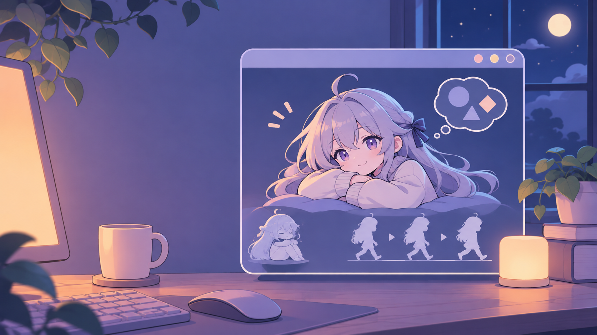

# Desktop Pet Motion Library

> **Archive status:** completed motion sample collection.

Six short desktop-pet clips are preserved as a compact reference library. The badge-like graphics visible in the clips are entirely fictional; the project owner confirmed they may be published unchanged.

## Clips

| File | Scene |
|---|---|
| idle-loop.mp4 | Resting idle pose |
| portrait-loop.mp4 | Close-up portrait motion |
| thinking-loop.mp4 | Thinking pose |
| walking-loop.mp4 | Walking loop |
| task-interaction-loop.mp4 | Task interaction |
| reading-analysis-loop.mp4 | Reading and analysis |

Container metadata was stripped from the archived copies. The image content and visible fictional graphics were not edited.

## License

The included original clips and this repository's generated cover are offered under CC BY-SA 4.0; see [LICENSE](LICENSE). Any third-party elements remain subject to their own rights and licenses.
